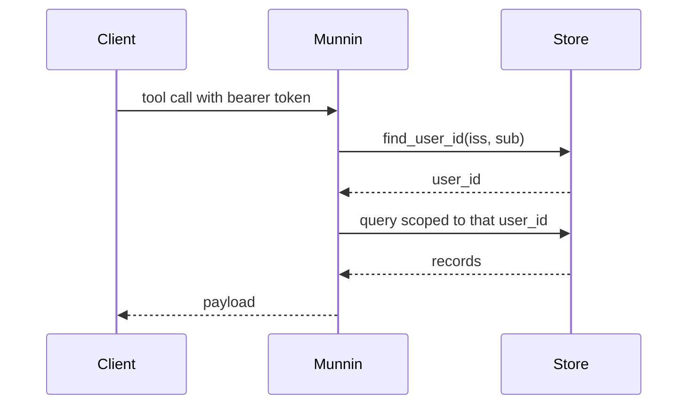
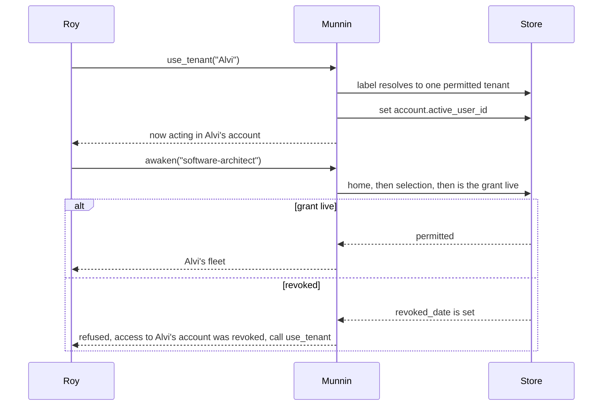
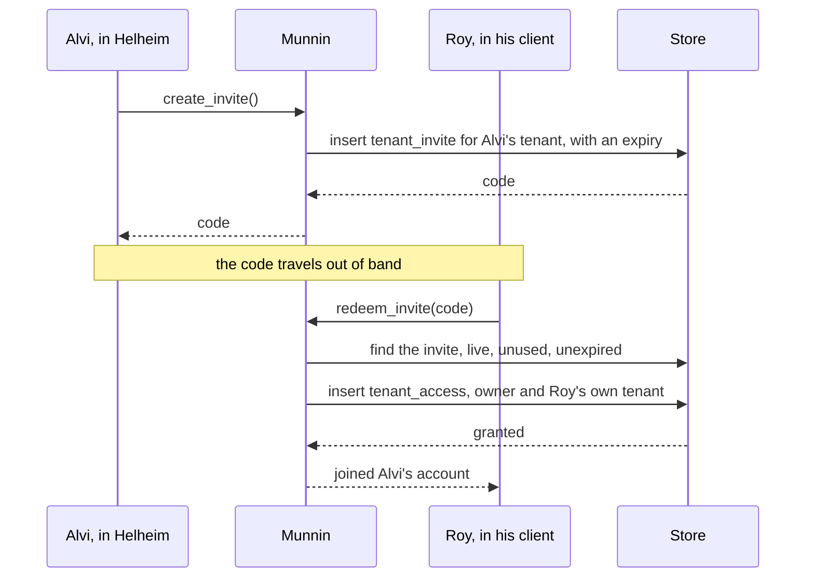

# High Wizard Plan

## **PROJECT INFO**
- **Project**: agent-memory-server (Valaskjalf / Munnin)
- **Date**: 2026-10-28
- **Agent**: software-architect
- **Theme**: Account sharing — a person joins another person's account with their own login, administered from Helheim
- **Source Protocol**: `/high-wizard` — /high-wizard

*CRITICAL INSTRUCTION: To continue this plan: load the source protocol above, then inspect which sections below are filled vs unfilled to infer your current step.*

---

## **INHERITED CONTEXT**
*Filled at investigation step 0 with whatever was settled before this plan existed. The two sources are recorded separately and never merged — write "None" under a part that does not apply.*
*These decisions are **not yours to reopen**. If one looks wrong, STOP and surface it to [USER-NAME] — do not silently re-decide it here or in Confirmed Decisions below.*

### From the Parent Plan
- **Parent plan**: None — not a sub-plan
- **Assigned scope**: None
- **Integration contracts**: None
- **Pushed-down open items**: None

### From Pre-Planning Discussion
- **Discussion**: "Pre-planning discussion with Alvi, 2026-10-28, this session"
- **Agreed scope**: One account is shared whole between two people. The person joining keeps their own Google login and never uses the owner's. The admin surface is Helheim, where the owner gives and revokes access. Granular sharing (per agent, per project context) is deliberately not built now.

| # | Settled decision | Chosen | His reason | Status |
|---|------------------|--------|------------|--------|
| 1 | Sharing axis | Whole account, not per agent and not per project | "I think that will be too much for now. just share all account so when I share my account to Roy, Roy can use that too without having to login using my google account" | Settled |
| 2 | Delivery shape | Build the sharing surface now, not the one-hour operator script | "B ofc", choosing the surface over the operator relink | Settled |
| 3 | Admin surface | Helheim dashboard is where access is granted and revoked | "we can use helheim dashboard to give access / revoke" | Settled |
| 4 | Tenant model | Two tenants per person: their own, plus any they were granted, selected explicitly; the default is their own | "we should have tenant. the default is our tenant. if user was invited (Roy), then Roy should have 2 tenant. his, and mine" | Settled |
| 5 | Switching | A procedure calls a tool that switches the active tenant | "then he should switch tenant using procedures, which then calls a tool to switch tenant" | Settled |
| 6 | Revocation | Access is refused at the point of use, not only at the moment of switching | "if the permission is revoked, then he should no longer able to access the tenant ... he will be rejected once he wants to modify / read the tenant" | Settled |
| 7 | Profile seed | The login provider's profile (at least the name) seeds a person's basic profile | "do we get anything from google login profile? we should use that as the basic profile (name, at least)" | Settled |

- **Considered and rejected**: Operator relink only → lost because he wants the surface now rather than a manual step repeated by hand. One identity mapped onto the shared account (the swap model, recommended in the round before this one) → displaced by tenant selection, because it erased the joiner's own account and made revocation destroy access instead of ending a grant. Per-agent and per-project sharing → deferred outright, not lost: "too much for now".
- **Left open**: Where the selected tenant is remembered, and whether it survives a restart or a second client · whose profile the fleet reads while the caller sits inside someone else's tenant · the invite mechanism and its expiry · whether writes record an author · whether a member may invite others · whether Helheim gets a dedicated members page or drives Munnin's tools through its existing generated forms.

---

## **OBJECTIVES**
Let a second person use a Munnin account with their own login. Access becomes a grant they can be given, switch into, and lose, while each person keeps a tenant of their own. It is administered from Helheim, and it changes neither whose memory a tenant is nor how any existing tool scopes a query.

### **Related Documents**
- [core-memory/0-core-user-profile.md](control-files/core-memory/0-core-user-profile.md) — the three authored profile lines, and why a blank field is a deliberate answer
- [docs/adr/2026-10-09-postgresql-store.md](docs/adr/2026-10-09-postgresql-store.md) — the store this schema grows on
- [docs/README.md](docs/README.md) — the faces, and the tenancy statement this feature qualifies
- [deploy/link-identity.py](../../deploy/link-identity.py) — in `munnin-deploy`, the operator link script this feature supersedes and leaves stale

### **SUCCESS CRITERIA**
- [ ] A token resolves to its own tenant by default, and to a granted tenant only after an explicit switch, through one resolver step shared by the MCP and HTTP faces
- [ ] Revoking a grant refuses the next read or write with a message naming the tenant, while the person's own tenant stays readable throughout
- [ ] An invite is single-use, expires, records who redeemed it, and can be revoked before use
- [ ] A tenant created by a first login carries a `user_profile` seeded with the provider's name and nothing else; an existing tenant's profile is never touched
- [ ] Both backends carry the same schema, and the migration, parity and isolation tests pass
- [ ] Helheim drives every membership tool with no change to Helheim
- [ ] One served procedure documents switching tenants and what a refused tenant looks like
- [ ] The privacy and terms pages describe sharing truthfully
- [ ] `deploy/link-identity.py` is reconciled with the Postgres store so its instruction is no longer wrong

---

## **SCOPE**

### In Scope
- The `tenant_access` grant table, the `tenant_invite` table, and `account.active_user_id` as the remembered selection
- One resolver step that turns a token into the active tenant, with the grant checked on every call
- Membership tools: list tenants, switch tenant, list members, invite, redeem, revoke, plus the owner check on the granting ones
- The `caller` block in the awaken payload, so an agent knows who is signed in while reading someone else's memory
- The profile seed at tenant creation, from the provider's name claim
- One served procedure for switching and for the refused-tenant case
- The privacy and terms text, and the operator script's reconciliation

### Out of Scope
- **Per-agent and per-project grants** — deferred at the owner's word ("too much for now"); the grant is whole-account
- **First-run bootstrap for seeded accounts** — a seeded profile is present with blank philosophy and vision, so the bootstrap does not fire. Accepted as the cheapest shape for a two-person instance; it becomes a real gap the moment the instance admits strangers, and is the first thing to revisit then
- **Authors on memory records** — a guest's writes are indistinguishable from the owner's, which is the deal at whole-account granularity
- **Members inviting members** — owner-only for this release
- **A guest's own authored profile** — a guest reads the account's profile, plus the `caller` block
- **A dedicated members page in Helheim** — the dashboard's generated forms already reach every tool
- **A browser accept page** — redeeming runs through the caller's own MCP client, because Munnin has no login page of its own
- **Tenant transfer, deletion, and an audit UI**

---

## **CONFIRMED DECISIONS**
*Decisions made **by this plan** — both **asked-and-confirmed** by [USER-NAME] AND **written-through** (Zone A and B decisions made by the agent, recorded with their reasoning). The reasons serve as the analysis record.*
*Decisions settled before this plan existed — by a parent, or in a pre-planning discussion — belong in [INHERITED CONTEXT](#inherited-context) above, not here. Keeping them separate is what shows which decisions this plan actually owns.*

| # | Decision | Chosen | Reason |
|---|----------|--------|--------|
| 1 | Release boundary | Membership plus a profile the fleet can read | Asked: owner/member roles and a per-person profile. The tenant model later made the roles structural, and the profile resolved into the seed plus the `caller` block |
| 2 | Whose profile a guest reads | The account's, with the signed-in person named in a `caller` block | The memory belongs to the account and the human in the chair is someone else; both facts are true at once, and the block is additive |
| 3 | Where the selection is remembered | Per person, persisted | A restart must not silently drop a session back to the home tenant, and a second client should see the same choice |
| 4 | Redeem ceremony | One call that writes the grant and reports what was joined | Leaving is one call away, and the code is the real commitment |
| 5 | Where the selection lives | `account.active_user_id`, nullable TEXT, no foreign key | One row per person is exactly the unit of choice; a dangling value is already handled by the grant check the read path must run; and a nullable column is the one migration shape both backends do in place |
| 6 | A config table | Not built | One per-person preference does not earn a table, and a generic key-value store becomes a second, unowned home for facts |
| 7 | What an invite is | A `tenant_invite` row, expiring, single-use, with a used-by stamp | A row can be revoked before use and records who came in; a signed token can do neither |
| 8 | Revocation | `revoked_date` on the grant | Distinguishes "access was revoked" from "no such tenant", and re-granting revives the same row |
| 9 | Profile seed | Name from the provider, philosophy and vision blank, written when the tenant is created | The owner's call ("leave them blank, easiest"), taken with its consequence recorded above |
| 10 | Where the seed writes from | An `on_created` hook on `IdentityService`, injected at the composition root | Tenant birth has exactly one site; a hook keeps the identity side from importing the memory side, and covers both faces at once |
| 11 | What the switch accepts | The tenant id, or a label when it matches exactly one permitted tenant | Labels are what an agent will read from the list, and an ambiguous label is refused rather than guessed |
| 12 | Who may grant | Only the owner of the tenant being acted on | Ownership is structural (your own tenant needs no grant), so the check is "is this the caller's home tenant", not a role column |

---

## **SOLUTION**

### Architecture Overview
Munnin already answers one question on every call: whose memory is this? This feature puts a second answer in front of it, which tenant is this person acting in, and a grant that authorises the answer. What any tool does with the answer does not change, so the forty-odd memory operations stay untouched and the new behaviour enters through the one seam they all share.

Three layers move. The store gains two tables and one column. A sharing repository and a sharing service own the grant rules. The resolver becomes the only place an active tenant is chosen, and the adapters gain membership tools that operate on identity rather than on memory.

### Component 1: Schema
- **Purpose**: hold the grant, the invite, and the remembered selection.
- **Key Files**: `src/munnin/data_entities/migrations/0005_tenant_sharing.sql`, `src/munnin/data_entities/migrations_postgres/0005_tenant_sharing.sql`

### Component 2: Sharing repository
- **Purpose**: read and write the grant and invite rows, and the active selection. Holds no tenant of its own, exactly like the identity repository, because it runs before a tenant is chosen.
- **Key Files**: `src/munnin/data_entities/sharing.py`, `src/munnin/data_repositories/sharing_repository.py`, `src/munnin/data_repositories/postgres_sharing_repository.py`

### Component 3: Sharing service
- **Purpose**: the rules. Who may grant, whether an invite is live, whether a tenant is permitted, what a refusal says.
- **Key Files**: `src/munnin/business_services/sharing_service.py`

### Component 4: Resolver and composition
- **Purpose**: turn a verified token into the active tenant in one place, and keep the sharing tools reachable when a selection has gone bad.
- **Key Files**: `src/munnin/business_services/tenant_resolver.py`, `src/munnin/business_services/service_factory.py`, `src/munnin/app.py`, `src/munnin/api_http/api.py`, `src/munnin/api_mcp/server.py`

### Component 5: Membership tools
- **Purpose**: list tenants, switch, list members, invite, revoke an invite, redeem, revoke a member. Available on both faces, because the store's own ADR-013 states that the HTTP face exposes the full surface.
- **Key Files**: `src/munnin/api_mcp/server.py`, `src/munnin/api_http/api.py`

### Component 6: Profile seed
- **Purpose**: give a tenant born from a first login a profile carrying the provider's name, so the fleet has something to address from the first turn.
- **Key Files**: `src/munnin/business_services/identity_service.py`, `src/munnin/business_services/profile_seed.py`

### Component 7: Served procedure, docs, and the operator script
- **Purpose**: tell an agent when to switch and what a refused tenant means; correct the published pages; reconcile the link script with the Postgres store.
- **Key Files**: `control-files/procedures/memory/tenant-sharing.md`, `src/munnin/api_pages/pages.py`, `docs/README.md`, `../../deploy/link-identity.py`

<!-- OPTIONAL SECTION A: Include when multi-system changes, multiple components interacting -->
### Integration Architecture

| Component | Integrates With | Data Flow | Dependencies |
|-----------|----------------|-----------|--------------|
| Resolver | Sharing service, identity service | token → (iss, sub) → home tenant → selection → permitted tenant | `tenant_access`, `account` |
| Service factory | Resolver | permitted tenant → cached `MemoryService` scoped to it | `MemoryRepository` |
| Membership tools | Sharing service, resolver | caller's home tenant + argument → grant/invite rows | `account`, `tenant_access`, `tenant_invite` |
| Profile seed | Identity service, memory service | new tenant + provider name → one `shared_record` row | `shared_record` |
| Helheim | Munnin MCP face | tool list → generated form → the membership tools | nothing new in Helheim |

<!-- OPTIONAL SECTION A2: Include when a change alters a data shape/format/contract that CROSSES a system, service, or process boundary (a field's type/nullability, a string format, an enum value, a serialized payload, a DB column another app reads). Skip for single-system internal changes. -->
### Cross-System Contract Impact (Blast-Radius Check)

*A producer-side change to shared data silently breaks consumers that nobody updated in the same pass. Enumerate EVERY consumer of the changed shape and how each is verified BEFORE shipping. Producer and consumers are usually separate deploys.*

**Change classification** (check all that apply): ☐ field type/nullability ☑ string/ID format ☐ enum value added/changed ☑ new/removed field ☐ semantics changed (same shape, new meaning)

| # | Consumer (system + path) | How it couples (deserialize / string-parse / DB-read / migrate / display) | Breaks how on this change? | Verified / mitigated |
|---|---|---|---|---|
| 1 | Munnin clients and served procedures to `awaken` payload | deserialize | none, the `caller` key is additive | a test asserts existing keys are unchanged and the new one appears only when a caller is known |
| 2 | Markdown importer and exporter in `data_migrations/` | DB-read / DB-write | **silent-wrong**: an import that clears records could clear grants, and an exporter enumerating tables could try to write the new ones as markdown | the importer touches only `agent`, `shared_record` and `memory_record`; a test asserts a grant and an invite survive `--all` |
| 3 | SQLite to Postgres migration in `sqlite_to_postgres.py` | migrate | **silent-wrong**: its explicit table list would move memory and leave every grant behind | both new tables added to the list, with a round-trip test |
| 4 | Helheim to Munnin over MCP | deserialize (tool list and schema) | none, the new tools appear in its generated forms | exercised by hand against a running server |
| 5 | Operator script `deploy/link-identity.py` | string-parse / DB-write | already wrong on the Postgres backend, and this feature makes it obsolete for sharing | reconciled in this plan |
| 6 | Served framework procedures in `control-files/procedures/**` | display (instructions an agent follows) | **silent-wrong**: they state that the token names the tenant, which stops being the whole truth | a new procedure is served beside them and the tenancy sentences are corrected |
| 7 | Published pages in `api_pages/pages.py` | display | **silent-wrong**: the privacy policy claims every read is scoped to your own tenant | text corrected in the same release |

- **Deploy ordering**: schema first and automatically (repositories apply migrations on first connection), then the tools and the new procedure in the same image; Helheim needs nothing. A stale client is safe because every change is additive.
- **Existing data**: `active_user_id` is NULL for every existing account, meaning "act as yourself", so behaviour is unchanged until somebody invites. No backfill.
- **Project registry**: none exists for this repo; the table above is the record.

<!-- OPTIONAL SECTION B: Include when changing data/process flow, API changes -->
### System Flow Diagrams

**Current State:**

**End Result:**

**Joining, in its own order:**

<!-- OPTIONAL SECTION C: Include when significant technical constraints exist -->
### Technical Considerations
- **The identity and memory sides stay apart.** A tenant is created on the identity side and a profile is a memory record, so the seed arrives as an `on_created` hook injected at the composition root. `identity_service` never imports the memory repository.
- **The selection is read on every call.** One primary-key lookup on `account` and one on `tenant_access`, added to a request that already does several. Nothing is cached, so a revocation is visible on the next call rather than after a restart.
- **A bad selection must not lock the caller out of the cure.** Memory tools resolve the active tenant and raise a specific refusal when it is not permitted; the membership tools resolve only the home tenant, which keeps `use_tenant` reachable while every other tool refuses.
- **SQLite can add a column but not a constraint.** `active_user_id` carries no foreign key (decision 5), which is exactly the in-place shape `0003` used. The two new tables are plain `CREATE TABLE`, so neither backend rebuilds an existing table.
- **Twin migrations are a contract.** Every migration exists twice, and `test_twin_parity` and `test_migrations` compare them; a single-sided migration fails the suite rather than drifting.
- **Machine clients share their person's selection.** Helheim's and Einherjar's identity rows point at your account, so a switch made from Helheim moves your Claude session too. That is the accepted cost of per-person selection (decision 3) and belongs in the procedure so nobody reads it as a bug.
- **The template write gate does not cover `user_profile`.** `TEMPLATE_BY_RECORD_TYPE` lists only episode, reasoning, coding_reasoning, emotional and knowledge, so the seed needs no `template_version`, and `content_summary` is required only for episode and knowledge.
- **The end-to-end MCP path cannot be proven by a unit test.** It needs a real token from a real issuer, which is what makes the integration-coverage question at the end of this plan real rather than ceremonial.

<!-- OPTIONAL SECTION G: Include when task produces an architecture decision record -->
### ADR Output
*When this section is confirmed, the procedure creates a separate ADR file using the [ADR Template]([path-to-agent-memory-wizards]/templates/adr-template.md).*

- **ADR File**: `docs/adr/2026-10-28-tenant-sharing.md` (ADR-003)
- **Decision Summary**: Sharing a Munnin account is a grant on the tenant that a person selects, not a second login bound to the owner's identity.

---

## **IMPLEMENTATION PHASES**

### Phase 1: The store knows about grants
- [x] **Step 1.1**: Migration and entities
  - **Action**: add `0005_tenant_sharing.sql` to both backend migration sets, and the dataclasses.
  - **Implementation**: `tenant_access(tenant_user_id, member_user_id, granted_date, revoked_date)` keyed on both ids with foreign keys to `account`; `tenant_invite(code, tenant_user_id, created_by, created_date, expires_date, used_by, used_date, revoked_date)`; `ALTER TABLE account ADD COLUMN active_user_id TEXT`. `data_entities/sharing.py` carries `TenantAccess`, `TenantInvite` and `TenantRef`.
  - **Testing**: a fresh database and a database already at `0004` both apply cleanly; `test_migrations`, `test_twin_parity` and `test_schema` are extended with the new shapes; existing rows are asserted unchanged.
  - **Success Criteria**: both backends reach the same logical schema, and no existing table is rebuilt.

- [x] **Step 1.2**: Sharing repository, both backends
  - **Action**: the Protocol and its two implementations.
  - **Implementation**: `list_tenants_for`, `get_active`, `set_active`, `is_permitted`, `grant`, `revoke`, `list_members`, `create_invite`, `get_invite`, `use_invite`, `revoke_invite`. Constructed without a tenant, like `IdentityRepository`, because it answers before one is chosen.
  - **Testing**: the repository contract suite run against SQLite and Postgres, mirroring `test_repository_contract`.
  - **Success Criteria**: identical behaviour on both backends, including date formats and the idempotent re-grant.

- [x] **Step 1.3**: Data movement knows the new tables
  - **Action**: keep grants and invites alive through an import or a migration.
  - **Implementation**: `sqlite_to_postgres.py` gains both tables and `account.active_user_id`; the importer and exporter are checked for anything that clears or enumerates tables wholesale.
  - **Testing**: a grant and an invite are created, `import --all` runs, and both survive with their columns intact.
  - **Success Criteria**: an import or a backend migration cannot silently drop access.

### Phase 2: Rules and the one choke point
- [x] **Step 2.1**: Sharing service
  - **Action**: put every grant rule in one place.
  - **Implementation**: owner check (`active == home`), self-grant refused, invite must be live, unused and unexpired, a label resolves only when it matches exactly one permitted tenant, revoke sets `revoked_date`, redeem uses the invite and inserts the grant in one transaction.
  - **Testing**: one test per rule, each failing if the rule is removed; refusal messages asserted verbatim.
  - **Success Criteria**: no rule lives in an adapter.

- [x] **Step 2.2**: Resolver and composition
  - **Action**: choose the active tenant once, and refuse a revoked selection without trapping the caller.
  - **Implementation**: `TenantResolver` gains `current_home_user_id()`; `current_user_id()` returns the permitted active tenant and raises `TenantAccessRevoked` naming it otherwise; `LocalTenantResolver` returns the same for both; `ServiceFactory` receives the sharing repository.
  - **Testing**: `test_tenant_resolver` covers home, active, revoked and never-granted; `test_isolation` proves a switched caller reaches only the selected tenant.
  - **Success Criteria**: every tool inherits the behaviour without an adapter edit, and `use_tenant` still answers while everything else refuses.

### Phase 3: The two faces
- [x] **Step 3.1**: Membership tools on MCP
  - **Action**: seven tools with titles and annotations.
  - **Implementation**: `list_tenants`, `use_tenant`, `list_members`, `create_invite`, `revoke_invite`, `redeem_invite`, `revoke_member`; the granting four resolve the caller's home tenant and refuse when the caller does not own the tenant acted on. `list_members` includes the owner, labelled as such, so the room reads complete.
  - **Testing**: `test_tool_annotations` plus dispatch tests against a fake sharing service, including each refusal.
  - **Success Criteria**: Helheim lists and drives them with no Helheim change.

- [x] **Step 3.2**: The same seven on HTTP
  - **Action**: mirror them, because ADR-013 states the HTTP face exposes the full surface.
  - **Implementation**: routes mapped to the same service; the revocation refusal becomes a 403 carrying its message.
  - **Testing**: `test_route_coverage` plus a 403 case and a parity case per tool.
  - **Success Criteria**: both faces answer identically for the same input.

- [x] **Step 3.3**: The caller block
  - **Action**: let `awaken` say who is signed in.
  - **Implementation**: `MemoryService.awaken(domain, caller=None)` adds `caller: {user_id, display_name, is_guest}`; both adapters pass it; the name falls back to the account's email label and then to null, because an account created before name capture may carry neither.
  - **Testing**: the payload's existing keys are asserted unchanged and the new one present; a guest session is marked.
  - **Success Criteria**: a guest is distinguishable from the owner without reading the tenant.

### Phase 4: The seed
- [x] **Step 4.1**: Profile seed and its hook
  - **Action**: a tenant born from a login gets a profile carrying the provider's name.
  - **Implementation**: `IdentityService.resolve(..., on_created=...)` calls the hook only when it created the tenant; `profile_seed.py` writes one shared `user_profile` record holding the template's three lines with the name filled; wired at the composition root.
  - **Testing**: the hook fires once on creation and never on a repeat login; the record is exactly one and its content matches the template's shape; an authored profile is never touched; a failing seed logs and does not fail the login.
  - **Success Criteria**: a new tenant awakens with a profile, a repeat login writes nothing, and no login can be broken by the seed.

### Phase 5: What people read
- [x] **Step 5.1**: Served procedure
  - **Action**: tell an agent when to switch and what a refusal means.
  - **Implementation**: `control-files/procedures/memory/tenant-sharing.md`, discovered automatically by the content loader, covering the default tenant, list-then-switch, the shared selection across a person's clients, and the revoked refusal.
  - **Testing**: `read_procedure` returns it, and the content-loader tests still pass.
  - **Success Criteria**: an agent that reads only the procedure can operate the feature.

- [x] **Step 5.2**: Pages and docs
  - **Action**: stop the published text from claiming what is no longer true.
  - **Implementation**: the privacy and terms sentences about scope and sharing, the tenancy statement in `docs/README.md`, and the ADR cross-reference.
  - **Testing**: `test_pages` assertions.
  - **Success Criteria**: nothing published states that a token alone names the tenant.

- [x] **Step 5.3**: The operator script
  - **Action**: reconcile `deploy/link-identity.py` with the deployed store.
  - **Implementation**: either a Postgres path beside the SQLite one, or retirement in favour of the tools, with its docstring updated to say which.
  - **Testing**: a dry run against a scratch database on each backend it still claims to support.
  - **Success Criteria**: following its own instructions changes the store the box actually serves from.

---

## **EXECUTION LOG**
**Execution Protocol for AI**:
I have to use this document as my **ONLY** source of truth to execute and track the plan steps iteratively. I should **NOT** use additional tools like ToDos because it lacks the context of what should I do. Everytime I want to implement a step I have to check the reference to the original step plan above. Everytime a step has been finished I need to go back to this document to log what was done.
*In other words*:
- I have to make this document as the source of truth for the implementation phase on what I have worked on and what I will be working
- The original plan must be fully in my context, therefore, I have to make sure I loaded the **Plan File** before executing any task and read carefully the reference to the original step
- I have to do the implementation by doing it in order per step THEN, I ALWAYS have to fill the step log rightly after

**Definition of Done (applies to ALL steps)**:
- ✅ **Code Quality**: Code compiles/runs without errors
- ✅ **Testing**: Tests written and passing
- ✅ **Logged**: Implementation and testing logged below
- 🚫 **Blocked**: Get input from [USER-NAME] before assuming

### Phase 1:
- [x] **Step 1.1**: [link to step above]
  - **Implementation Log**: `migrations/0005_tenant_sharing.sql` and `migrations_postgres/0004_tenant_sharing.sql` written (the Postgres set is one number behind by design, and the twin's header says why), plus `data_entities/sharing.py` carrying `TenantAccess`, `TenantInvite` and `TenantRef`. `tenant_access` is keyed on both ids with foreign keys to `account`; `tenant_invite` is keyed on its code; `account` gained a nullable `active_user_id` with no foreign key, per decision 5.
  - **Testing Log**: `uv run pytest tests/data_entities -q` → 45 passed. New `tests/data_entities/test_sharing_schema.py` (5 tests: the tables exist, the column is NULL by default, a grant must name two real accounts, one row per pair, an invite needs a real tenant and a unique code). New retrofit test in `test_migrations.py` runs 0001 through 0005 directly on a store at the 0004 shape and asserts the existing account and its memory survived; the older retrofitted-case test now expects `0005_tenant_sharing` and a five-row history.
  - **Success Criteria**: Pass. A fresh database and one already at 0004 both apply cleanly, and no existing table was rebuilt.
  - **Tech Debts**: None.
  - **Result**: Meets the criteria.

- [x] **Step 1.2**: [link to step above]
  - **Implementation Log**: `data_repositories/sharing_repository.py` holds the `SharingRepository` Protocol and `SqliteSharingRepository`; `postgres_sharing_repository.py` is its twin. Neither takes a tenant, like the identity repository. `redeem` is a single transaction: claim the invite, then upsert the grant. `grant` revives a revoked row instead of adding a second (SQLite upsert, Postgres `ON CONFLICT DO UPDATE`).
  - **Testing Log**: `tests/data_repositories/test_sharing_repository.py`, the same assertions against both backends: 12 passed on SQLite, 12 skipped for Postgres because `MUNNIN_PG_TEST_URL` is not set here. Covers the selection round trip and clear, idempotent grant, revoke then re-grant reviving one row, the tombstone staying visible, invite round trip, exactly-one-use, expired and revoked and unknown codes writing nothing, a code refusing to admit its own tenant, a used invite not being re-revokable, and the label preferring display name then email.
  - **Success Criteria**: Pass on SQLite. The Postgres twin is written but was not executed in this environment.
  - **Tech Debts**: The Postgres parameter of the contract skips without a local server, so that half is proven by construction and review rather than by a run. Stated rather than hidden.
  - **Result**: Meets the criteria on SQLite, with the Postgres caveat recorded.

- [x] **Step 1.3**: [link to step above]
  - **Implementation Log**: `sqlite_to_postgres.py`'s `_TABLES` gained `tenant_access`, `tenant_invite` and `account.active_user_id`, so `verify`'s per-table count loop covers them with no further change. Read the importer's purge: it deletes only `memory_record`, `shared_record` and `agent`, and leaves `account` alone, so access survives an import by design rather than by luck.
  - **Testing Log**: new `tests/data_migrations/test_sharing_survives_data_movement.py` seeds a grant, an invite and a selection, runs `_purge_tenant`, and asserts the agent and its record are gone while all three survive; a second test pins the migration's column list structurally, so removing a table from it fails the suite. Combined run over `data_entities`, `data_repositories` and `data_migrations`: 253 passed, 31 skipped.
  - **Success Criteria**: Pass. Neither an import nor a backend migration can drop access silently.
  - **Tech Debts**: None.
  - **Result**: Meets the criteria.

### Phase 2:
- [x] **Step 2.1**: [link to step above]
  - **Implementation Log**: `business_services/sharing_service.py`, holding every rule: the owner check (`acting == home`), invite minting with a seven-day expiry, revoke-by-tombstone, label resolution that refuses an ambiguous or unknown name, and `redeem`, which joins without switching. Five typed refusals (`NotOwner`, `NotPermitted`, `BadInvite`, `AmbiguousLabel`) so the adapters map them without parsing prose. One behaviour was hardened while writing: selecting your own tenant by label now clears the selection rather than storing your own id, so "act as yourself" has a single representation. A second was hardened during the QA walk: `TenantRef` gained `revoked`, and `list_tenants` now reports a selection whose access has ended instead of hiding it, because a person refused on every call could not otherwise see where they were standing; `use_tenant` refuses to re-enter it, and `test_a_selection_that_lost_access_is_still_shown_and_still_active` covers both halves.
  - **Testing Log**: `tests/business_services/test_sharing_service.py`, 16 tests against the real SQLite repository, one per rule: default tenant first, live grants only, switch by id and by unique label, ambiguous label refused, unknown refused, revoked says "was revoked", owner-only for all three granting calls while acting elsewhere, invite minted for the acting tenant with an expiry, members list with the owner first, revoke ending access and reviving one row, self-revocation refused, revoking a stranger refused, redeem joining without switching, a code used exactly once, revoked/expired/unknown each saying which, and your own tenant needing no invitation.
  - **Success Criteria**: Pass. No rule lives in an adapter.
  - **Tech Debts**: None.
  - **Result**: Meets the criteria.

- [x] **Step 2.2**: [link to step above]
  - **Implementation Log**: `TenantResolver` gained `current_home_user_id()`; `TokenTenantResolver` now resolves the home tenant and then the stored selection, and raises a new `TenantAccessRevoked` naming the tenant when the grant is gone rather than falling back to home. `LocalTenantResolver` answers both with its one constant. `ServiceFactory` takes the sharing repository and hands out `sharing_for(home)`, which deliberately reads the raw selection rather than the resolved one, so `use_tenant` stays reachable while memory tools refuse. `app.py` builds the sharing repository per backend.
  - **Testing Log**: `tests/business_services/test_tenant_resolver.py` extended to four new cases (a live selection wins; a revoked selection refuses and still answers for home; a never-granted selection refuses; selecting your own tenant equals no selection), and the existing two refusals still pass. The whole HTTP and MCP suite was run: 191 passed.
  - **Success Criteria**: Pass. Every tool inherits the behaviour through the one seam, and `use_tenant` remains reachable.
  - **Tech Debts**: None.
  - **Result**: Meets the criteria.

### Phase 3:
- [x] **Step 3.1**: [link to step above]
  - **Implementation Log**: seven tools in `api_mcp/server.py` with titles and annotations: `list_tenants`, `use_tenant`, `list_members`, `create_invite`, `revoke_invite`, `redeem_invite`, `revoke_member`. Each reads the caller's **home** tenant through `factory.sharing_for(...)`, so none of them sits behind the selection check, and each turns a `SharingError` into a `ToolError` carrying the service's own message.
  - **Testing Log**: `tests/api_mcp/test_sharing_tools.py`, four tests: the seven are served with titles; the whole owner→invite→redeem→switch→members→revoke flow runs through the face with the store checked afterwards; a guest acting in somebody else's tenant is refused from inviting and revoking; an unknown code arrives as a tool error rather than a crash. Two pinned-surface tests were updated deliberately: `test_tool_annotations` now places all seven, and `test_twin_parity`'s data-tool list names 24 tools with content served (29 with the content tools).
  - **Success Criteria**: Pass. Helheim needs no change: its forms are generated from the tool list.
  - **Tech Debts**: None.
  - **Result**: Meets the criteria.

- [x] **Step 3.2**: [link to step above]
  - **Implementation Log**: the same seven as HTTP routes. Both faces resolve the selection through one function, `SharingService.resolved_user_id()`, so they cannot drift, and a revoked selection answers 403 naming the tenant. **One structural change found while testing**: the membership routes could not live on the guarded `api` router, because its guard resolves the selection and therefore refused `use_tenant` exactly when it was needed. They moved to their own `identity_api` router guarded by the home caller, which is the plan's own rule made structural. The module docstring was rewritten in the same step, since it claimed a single guard.
  - **Testing Log**: `tests/api_http/test_sharing_routes.py`, three tests: the full flow, the 403 refusal on a memory route after revocation, and the switch back succeeding afterwards; a guest refused from inviting with a 403; a bad code arriving as a 400 with its reason. `test_route_coverage` was updated from 23 operations to 30, and its anonymous rule still holds for all seven new routes.
  - **Success Criteria**: Pass. Both faces answer identically for the same input, from one implementation.
  - **Tech Debts**: None.
  - **Result**: Meets the criteria, with the router split recorded above.

- [x] **Step 3.3**: [link to step above]
  - **Implementation Log**: `MemoryService.awaken(domain, caller=None)` gains a top-level `caller`, added only when a face supplies it so that "nobody told us" stays distinguishable from "a guest". `SharingService.caller_block()` reports the **home** tenant, its label, and `is_guest`; both faces pass it.
  - **Testing Log**: `test_sharing_routes` asserts the block while Roy sits inside Alvi's account, and every existing awaken test still passes because the key is absent when the caller is unknown.
  - **Success Criteria**: Pass. A guest is distinguishable from the owner without reading the tenant.
  - **Tech Debts**: None.
  - **Result**: Meets the criteria.

### Phase 4:
- [x] **Step 4.1**: [link to step above]
  - **Implementation Log**: `business_services/profile_seed.py` holds the three-line template and `seed_profile`, which refuses to write without a name and never touches an existing profile. `IdentityService` gained an `on_created` hook, wired once at the composition root rather than accepted as a `resolve` argument: the hook belongs to the composition, not to each of three call sites. A failing hook logs and the login still succeeds. `build_app` wires it to `seed_profile(factory.for_user(user_id), display_name)`.
  - **Testing Log**: `tests/business_services/test_profile_seed.py`, six tests: the hook fires once for a new tenant and never on a repeat login; a raising hook does not fail the login; the record is exactly one and matches the template's three lines; no name writes nothing, leaving the first-run bootstrap alive; an authored profile is never overwritten; and a seeded profile comes back through `awaken`.
  - **Success Criteria**: Pass.
  - **Tech Debts**: None.
  - **Result**: Meets the criteria.

### Phase 5:
- [x] **Step 5.1**: [link to step above]
  - **Implementation Log**: `control-files/procedures/memory/tenant-sharing.md` written in the framework's own shape: what the tenants are, how to read `list_tenants`, when and how to switch, what a refusal means, the owner-only calls, and the three facts that surprise people (the choice is per person, joining does not switch, your own tenant is untouched). The loader discovers procedures from the directory, so no registration was needed; its argument map gained an entry, since every served procedure declares one.
  - **Testing Log**: the content suite refused the first version — `test_every_procedure_declares_its_optional_argument` — which is the guard working as designed; the entry was added and `tests/content` passes. Full suite afterwards: 622 passed, 40 skipped.
  - **Success Criteria**: Pass. The procedure is served through `read_procedure` like any other.
  - **Tech Debts**: None.
  - **Result**: Meets the criteria.

- [x] **Step 5.2**: [link to step above]
  - **Implementation Log**: the privacy policy's claim that every read and write is scoped to *your own tenant* was rewritten to describe the account actually being acted in, the owner-issued invitation, and revocation at any time. The terms' acceptable-use line now says *beyond access an owner has explicitly granted you*. `docs/README.md` gained one paragraph stating that sharing is a grant, not a login, and that record scoping is unchanged.
  - **Testing Log**: `tests/api_http/test_pages.py` passes unchanged, since the page assertions are structural.
  - **Success Criteria**: Pass. Nothing published states that a token alone names the tenant.
  - **Tech Debts**: None.
  - **Result**: Meets the criteria.

- [x] **Step 5.3**: [link to step above]
  - **Implementation Log**: `deploy/link-identity.py` (in `munnin-deploy`) rewritten to read the backend from the same configuration the server does and talk to either repository, instead of opening a SQLite file unconditionally. It now reads its own write back and refuses if the mapping does not resolve as intended, and it says plainly that account sharing is not this script's job — that is a grant, not a login. The SQLite backup is kept; for Postgres it prints that the backup is the operator's and does not pretend to have taken one.
  - **Testing Log**: a dry run against a scratch SQLite store: first run links and reads back, second run reports `already mapped`, both exit 0. The Postgres branch was not executed here (no local server), which is recorded as a debt rather than implied as proven.
  - **Success Criteria**: Pass on SQLite. Following its own instructions now changes the store the box actually serves from, on the backend the box runs.
  - **Tech Debts**: the Postgres path of the operator script is unexecuted in this environment.
  - **Result**: Meets the criteria, with that Postgres caveat.

---

## **QUALITY REVIEW**
*Filled by procedure Step 16 (delegated to `/analyze-code-quality` in embedded mode) after all execution phases are complete. **Static** review — answers "is the code clean?".*

- **Scope**: reconciled against `git status --short`, which is how the newly created files were seen rather than taken from the log alone. Modified: `api_http/api.py`, `api_mcp/server.py`, `api_pages/pages.py`, `app.py`, `identity_service.py`, `memory_service.py`, `service_factory.py`, `tenant_resolver.py`, `content/loader.py`, `data_migrations/sqlite_to_postgres.py`, `docs/README.md`, plus six test files whose pins this feature legitimately moved. New: `data_entities/sharing.py`, the two migrations, `sharing_repository.py`, `postgres_sharing_repository.py`, `sharing_service.py`, `profile_seed.py`, one served procedure, and seven test files. Counted in `munnin-deploy`: `deploy/link-identity.py`
- **Quality Standard**: no `quality-standard.md` in this repository (searched with `**/quality-standard.md` at planning time and again here), so the framework's own dimensions were applied by judgment: correctness, cohesion, naming, and a docstring on every new module that says why rather than what
- **Findings**: three, all low, each recorded with its reasoning instead of being silently fixed. (1) `SharingService.list_tenants` asks the store for one label per grant rather than joining, which is an N+1 that costs nothing at the only sizes this table has, and would be worth a join only if lists grew past a handful. (2) An MCP call that carries the `caller` block resolves the identity twice, once for the service and once for the sharing rules; correct, and cheap, but it is one token lookup more than the work needs. (3) The served `INSTRUCTIONS` and `help` text do not mention tenant sharing, so a client learns about it from `list_procedures` or from a refusal. Nothing here is a defect: none of the three produces a wrong answer
- **Fixed**: six lint findings surfaced by `uv run ruff check src tests` (import order in three files, two over-length lines, one unused import), all auto-fixed or reflowed before the final run. `ruff check` is clean and the suite is 622 passed, 40 skipped

---

## **QA HANDOFF**
*Filled by procedure Step 17 after Quality Review is resolved. This plan is **not** runtime-verified — this section records the plan for that verification, which happens in a QA session with the stack up.*

- **Scope**: schema (both backends), the sharing repository and service, the resolver and composition, the seven membership tools on both faces, `awaken`'s caller block, the profile seed, the served procedure, the pages, and the operator script
- **QA instrument**: Set up (map + bench). `qa/qa-map.md` grades all four R/I/A/O phases as documented and the index resolves 4/4
- **Integration coverage**: **Walked 2026-10-31.** Token mode over HTTP with two stand-in identities exercised the boundary this plan crosses (a second person's login reaching a shared tenant, a write landing there, and the refusal after revocation). **Deployed** to the box the same day (`munnin-web-b9f7a0e`): the migration applied to the live store at `0003`, and the operator script's Postgres branch linked and refused correctly on a scratch database. Still unrun: a **real issuer**, and the live **Helheim** run
- **Checklist**: [qa/checklists/account-sharing.md](../qa/checklists/account-sharing.md) — 18 of 24 rows walked; 6 waiting on a double redeem (covered by a unit test), a live import, a token against the proxy, or Helheim
- **Coverage split**: 52 automated (5 schema, 12 repository across both engines, 2 data movement, 16 service rules, 4 resolver, 4 MCP, 3 HTTP, 6 seed) / 24 manual across seven groups, of which 3 are UI-bound (Helheim's generated forms)
- **Runtime verification**: **PARTIAL, 2026-10-31.** Local mode passed OBSERVE; token mode walked groups B, C, D and E over HTTP; the box was deployed and groups F1 and F3 walked there. Remaining: a real issuer, Helheim with a real login, and F2/F4. Note for whoever runs it: a deployed container is **healthy before it is migrated** (migrations run on the first store connection), so read `migration_history` rather than trusting `docker ps`

> Do not read a filled checklist as a passed one. This section says a verification *plan* exists, nothing more.

---

## **POST-COMPLETION**
After all phases are executed, logged, and both **Quality Review** + **QA Handoff** are filled, move this plan to `plans/completed/`:
`mkdir -p ./plans/completed && mv ./plans/[this-file].md ./plans/completed/[this-file].md`
